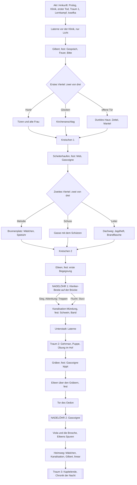

# Kapitel 1: Yharnam als Entscheidungsbuch (Gerüst, Stand 2026-11-06)

**Umbau abgeschlossen am 2026-11-06** nach `docs/struktur-entscheidungsbuch.md` (Fassung 2, Abschnitte 8 und 9: Entscheidungen des Nutzers). Das Kapitel ist kein Level mehr: Es geht immer voran, jede Station kommt höchstens einmal, es gibt keinen Rückweg und keine Drehscheibe. **Alle Texte stammen aus dem bisherigen Kapitel**; neu geschrieben ist nur, was die neue Reihenfolge verlangt (Übergänge, Platzhalter, Fragmente, Monologe). Neue Prosa folgt mit dem Skill `stil-1800`.

- Quelle der Wahrheit: `story/kapitel1/*.ink`, `story/system.ink`, `story/traum.ink`, `story/nachbild.ink`
- Erzählbaum (automatisch erzeugt): `web/twine.json`, `docs/yharnam-kapitel1.twee`; Knotenkarte: `docs/karte-kapitel1.md`
- **Nichts ist vom Nutzer abgenommen (Stufe 2).** Wo das Gerüst vom Plan abweicht, steht es unter „Abweichungen“.

## 1 Ablauf

Der Tod führt aus jeder Station in das **Nachbild** (`story/nachbild.ink`) und von dort an den Anfang des Kampfes (siehe 4).

## 2 Akte und Stationen

| Akt | Station | Art | Inhalt (ein Satz) | Knoten |
|---|---|---|---|---|
| I | Prolog | fest | Kutsche, Herkunft, Grund. | `k1_prolog` |
| I | Klinik | fest | Vertrag, Transfusion, Vision. | `k1_klinik` |
| I | Erwachen, erster Tod | fest | Die Bestie im Saal, unausweichlicher Tod. | `k1_erwachen` |
| I | Traum 1 | fest | Garten, Puppe leblos, Boten, Sägespalter, Feuerwaffe. | `k1_traum_erst` |
| I | Lernkampf | Kampf | Bestie in der Klinik, drei Takte. | `k1_klinik_kampf` |
| I | Iosefkas Tür | fest | Ampulle, ihre Stimme. | `k1_iosefka` |
| I | Laterne vor der Klinik | fest | Boten am warmen Eisen; die Laterne ist nur Licht, kein Weg. | `k1_laterne_zentral` |
| II | Gilbert | fest | Gespräch, Feuer, Bitte um den Bericht. | `k1_b_gilbert` |
| II | Ankunft | fest | Yharnam, Rauch, Räucherwerk. | `k1_b_ankunft` |
| II | **Erstes Viertel** | 2 von 3 | Drei Spuren: Hund, Glocke, offene Tür. | `k1_viertel1` |
| II | Türen und alte Frau | wählbar | Stimmen hinter Türen, Violas Spur, Versprechen eines sicheren Ortes. | `k1_b_tueren` |
| II | Kirchenanschlag | wählbar | Anschlag der Kirche, Kreide auf der Tür, Atmen dahinter. | `k1_b_anschlag` |
| II | Dunkles Haus | wählbar | Rollstuhl-Schütze, Zettel über die gesperrte Brücke, **Fundstück: Wendels Mantel**. | `k1_b_haus` |
| II | Scheiterhaufen | fest | Mob, Gascoigne rettet dich, Parade, Gruß an seine Frau. | `k1_b_scheiterhaufen` |
| II | **Zweites Viertel** | 2 von 3 | Drei Spuren: Melodie, Schuss, Leiter. | `k1_viertel2` |
| II | Brunnenplatz | wählbar | Das Mädchen, Spieluhr, falsche Entscheidung möglich. | `k1_b_maedchen` |
| II | Gasse mit dem Schützen | wählbar | Schuss von hinten; Kiesel, Brandflasche. | `k1_b_daecher` |
| II | Dachweg (neu) | wählbar | **Fundstück: Jagdheft eines Toten**, Brandflasche, Kiesel; Blick auf die anderen Wege. | `k1_b_dachweg` |
| II | Eileen | fest | Erste Begegnung in zwei Formen (Dachweg oder Krampen am Kanaleingang). | `k1_b_eileen` |
| II | Weg zur Brücke | fest | Ein Absatz. | `k1_vor_bruecke` |
| III | **NADELÖHR 1** Kleriker-Bestie | fest | Kämpfen, ablenken, fliehen; Gascoigne als Helfer; **Fundstück: Brief der Kirche**. | `k1_n1_kleriker` |
| III | Kanalisation-Mündung | fest, auf allen Wegen | Das Schwein; bei fortgeschicktem Mädchen das rote Band. | `k1_c_kanal` |
| III | Unterstadt, Laterne | fest | Ankunft, kaltes Licht der Laterne. | `k1_c_unterstadt` |
| III | **Traum 2** | fest | Gehrman, Puppe, Übung im Hof (Parade), Fragmente. | `k1_traum_zwei` |
| III | Gräber | fest | Gascoigne kippt: erinnern, warnen, fragen. | `k1_c_graeber` |
| III | Eileen über den Gräbern | fest | Schonung erbitten, Zusammenarbeit anbieten, schweigen. | `k1_c_eileen` |
| III | Tor des Oedon | fest | Letzte Gelegenheit zur Ampulle. | `k1_c_tor` |
| III | **NADELÖHR 2** Gascoigne | fest | Acht Takte in drei Phasen. | `k1_n2_gascoigne` |
| IV | Viola und die Brosche | fest | Schlüssel, Brosche, Eileens Spuren. | `k1_d_grab` |
| IV | Heimweg | fest | Ein Absatz, dann: Fenster des Mädchens (wenn sie wartet), Kanalisation (nach der Brosche), Gilbert (wenn du ihm den Bericht versprochen hast). | `k1_d_heimweg` bis `_d` |
| IV | **Traum 3** | fest | Kapitelende: Puppe, Fragmente, Chronik der Nacht (nennt auch, was du nicht erlebt hast), Aufzeichnungen. | `k1_d_traum` |

## 3 Fadentabelle

Welcher Faden auf welcher Route, in welcher Form, mit welcher Art von Folge (Färbung, Besetzung, Zugang, Kampf).

| Faden | Wo | Pflicht? | Folge |
|---|---|---|---|
| **Gascoigne** | Scheiterhaufen (fest) → Brücke (als Helfer, wenn gerufen) → Gräber (fest) → Grab (Boss) | ja, auf jeder Route | Freundschaft (Färbung, Zugang zum Moment der Klarheit), Parade (Kampf), Verrat (Besetzung: nicht mehr rufbar) |
| **Eileen** | Dachweg oder Krampen (fest) → Gräber (fest) → nur Spuren | ja | Verrat/Warnung (Zugang: Partnerschaft Kapitel 2), Dank, Bruch |
| **Das Mädchen** | Brunnenplatz (Wahlstation) → Fenster im Heimweg (immer, wenn sie wartet) | halb: Heimweg zeigt sie immer | Spieluhr (Kampf), Band beim Schwein (Besetzung), Brosche (Zugang) |
| **Gilbert** | Gilbert (fest) → Heimweg (wenn Bitte angenommen) | ja | Feuer (Kampf: Mob, Brücke, Gascoigne), Versprechen (Färbung, später Blutmond) |
| **Iosefka** | Tür (fest) | ja | Wärme, Merkmal für Kapitel 2 |
| **Alte Frau** | Türen (Wahlstation) | nein | Versprechen eines sicheren Ortes |
| **Kirche und gesperrte Brücke** | Gilbert (Gerücht), Anschlag (Wahlstation), Zettel im dunklen Haus (Wahlstation), Tor am Brückenende (fest nach Sieg/Ablenkung) | ja, über Gilbert | Lore, Fragment „Kirche“ |
| **Mantel (Wendel)** | Dunkles Haus (Wahlstation) → Gascoigne, Eileen | nein | Färbung (Gespräche), Lüge möglich |
| **Jagdheft** | Dachweg (Wahlstation) → Brücke, Schwein | nein | Kampf (eine Möglichkeit mehr) |
| **Brief der Kirche** | Beute der Kleriker-Bestie | nur bei Sieg | Lore, Saat für Kapitel 2 |
| **Gehrman, Puppe, Boten** | Traum 1, Traum 2, Traum 3, Nachbilder | ja | Parade und Übung (Kampf gegen Gascoigne), Lore |
| **Story-Fragmente** | Freigeschaltet an Stationen, gespielt nach einem Tod, spätestens im nächsten Traum | ja, garantiert | Lore, Deutung des Jägers |

## 4 Tod, Nachbild, Fragmente

- Der Tod bringt eine kurze Todesszene (je Ort, schon vorhanden) und dann das **Nachbild**: wenige Sätze Körper im Garten, ein innerer **Monolog** (je Todesort zwei bis drei Varianten, dazu Zusätze je nach Entscheidung), als Letztes ein **Story-Fragment**, wenn eines freigeschaltet und noch nicht gespielt ist. Dann zurück an den Anfang des Kampfes (`kampfanfang`). Die Ampulle ist wieder gefüllt, ohne Meldung.
- **Fragmente** (Platzhalter): `fr_blut` (Gilbert), `fr_menschen` (Gilbert, Scheiterhaufen), `fr_kirche` (Anschlag, dunkles Haus), `fr_ich` (Kleriker-Bestie), `fr_nacht` (vor der Brücke), `fr_kippen` (Gräber). Nicht abgespielte Fragmente kommen als Gedanken beim Einschlafen in Traum 2 und Traum 3, so geht keine Lore verloren.
- **Feste Traumszenen**: Traum 1 (erster Tod, Klinik), Traum 2 (Laterne am Eingang der Unterstadt), Traum 3 (Kapitelende). Dazu das Nachbild nach jedem Tod.

## 5 Was entfallen ist (Buchgefühl statt Videospiel)

Blutechos samt Fleck am Todesort · Stärkung bei der Puppe · Bad der Boten samt Handel · Jägermarken · Laternen als Speicherpunkte und Rückweg dorthin · Leiter in der Kanalisation und jeder Rückweg · Hub-Auswahlen („noch einmal dorthin“) · Zähler Echos und Marken in der Leiste. Was die Boten verkauften, liegt jetzt in der Geschichte: Brandflasche und Kiesel (Dachweg, Schütze), Jagdheft (Dachweg), Brief (Beute der Bestie), Mantel (dunkles Haus). Die Blutampulle bleibt.

## 6 Abweichungen vom Plan (Fassung 2)

1. Ablenken führt wie der Sieg über die Treppen (der vorhandene Text beschreibt die Treppen); nur die Flucht führt durch den Sturz in den Kanal. Alle drei Wege passieren die Kanalisation-Mündung mit dem Schwein.
2. Das Schwein wird hier erzählt, nicht im Heimweg; im Heimweg bleibt die Kanalisation nur für das Mädchen nach der Brosche.
3. Eileens Spuren liegen am Grab, gleich nach Viola, nicht am Ende des Heimwegs (Ort der Spuren).
4. Eileens zweite Form der ersten Begegnung ist nur ein Satz Unterschied im Auftakt (Dachweg oder Krampen); eine eigene Szene folgt, wenn der Nutzer es will.
5. Die Chronik nennt Nichtgewähltes in je einer Zeile; die „Spuren des Nichtgewählten“ im Spiel selbst sind je ein Satz nach dem Viertel.
6. Das Gilbert-Gespräch „Nach den Jägern der Kirche fragen“ hängt nur noch an der Frage nach dem Weg zur Kathedrale (vorher an einer späteren Entdeckung).

## 7 Echo-Tabelle (erzeugt aus `web/entscheidungen.json`)

Jede Entscheidung, die etwas setzt, wird später in einem anderen Knoten gelesen. `node tools/entscheidungen.mjs --streng` (Teil von `npm run check`) erzwingt das. Ausgenommen sind Zähler (`v1_zahl`, `v2_zahl`, `tuer_stimme`, `uhr_bestie`, `puppe_besucht`).

| Gesetzte Variable | Gelesen in |
|---|---|
| `alte_frau` | Heimweg (Akt IV, linear); Notizbuch |
| `alte_frau_versprochen` | Kapitelende im Traum |
| `band` | Kanalisation (Schwein, Leiter); Kapitelende im Traum |
| `brosche` | WEICHE: Was sagst du dem Mädchen? |
| `eileen` | Eileen die Krähe (Dach); Eileen über den Gräbern; Kapitelende im Traum; Notizbuch; Viola und die Brosche |
| `eileen_genannt` | Eileen über den Gräbern; Kapitelende im Traum; Notizbuch |
| `eileen_name` | Notizbuch |
| `feuerwaffe = „donnerbuechse“` | Nachbild: Tod und Rückkehr |
| `feuerwaffe = „pistole“` | Lernkampf in der Klinik |
| `frau_betet` | Notizbuch |
| `gascoigne` | Die Gräber (zweite Begegnung mit Gascoigne); Kapitelende im Traum; NADELÖHR 1: Kleriker-Bestie; NADELÖHR 2: Gascoigne; Nachbild: Tod und Rückkehr; Notizbuch; Scheiterhaufen und Mob, erste Begegnung mit Gascoigne |
| `gascoigne_gewarnt` | Kapitelende im Traum; Notizbuch; Viola und die Brosche |
| `gascoigne_lied` | Kapitelende im Traum |
| `gascoigne_name` | Die Gräber (zweite Begegnung mit Gascoigne); NADELÖHR 2: Gascoigne; Notizbuch |
| `gascoigne_verraten` | Die Gräber (zweite Begegnung mit Gascoigne); Kapitelende im Traum; NADELÖHR 1: Kleriker-Bestie; Nachbild: Tod und Rückkehr; Viola und die Brosche |
| `gedaechtnis_kleriker` | NADELÖHR 2: Gascoigne; Notizbuch |
| `gehrman_bestien` | Notizbuch |
| `gehrman_blut` | Notizbuch |
| `gehrman_jaeger` | Notizbuch |
| `gehrman_nacht` | Notizbuch |
| `gehrman_versprochen` | Notizbuch |
| `gehrman_wann` | Notizbuch |
| `gilbert` | Gilbert hören lassen, was hinter der Brücke liegt; Kapitelende im Traum; Notizbuch |
| `gilbert_bruecke` | Notizbuch |
| `gilbert_jagd` | Notizbuch |
| `gilbert_kleriker` | NADELÖHR 1: Kleriker-Bestie; Notizbuch |
| `grund = „heilung_selbst“` | Erwachen und erster Tod; Kapitelende im Traum |
| `grund = „luege“` | Iosefkas Klinik: Transfusion; Kapitelende im Traum |
| `grund = „schweigen“` | Kapitelende im Traum |
| `gruss_ausgerichtet` | Notizbuch; WEICHE: Was sagst du dem Mädchen? |
| `haltung_vertrag = „blind“` | Kapitelende im Traum |
| `haltung_vertrag = „wach“` | Notizbuch |
| `haltung_vertrag = „zoegernd“` | Kapitelende im Traum |
| `herkunft = „adel“` | Iosefkas Klinik: Transfusion |
| `herkunft = „gelehrter“` | Die Gräber (zweite Begegnung mit Gascoigne) |
| `herkunft = „gesuchter“` | Scheiterhaufen und Mob, erste Begegnung mit Gascoigne |
| `herkunft = „kranker“` | Gilbert |
| `herkunft = „soldat“` | Scheiterhaufen und Mob, erste Begegnung mit Gascoigne |
| `herkunft = „ueberlebender“` | Kanalisation (Schwein, Leiter) |
| `im_lied_getroffen` | Kapitelende im Traum |
| `iosefka` | Kapitelende im Traum; Notizbuch |
| `jagdnotizen` | Kanalisation (Schwein, Leiter); NADELÖHR 1: Kleriker-Bestie |
| `kiesel` | Die Gasse unter den Dächern (Schütze); NADELÖHR 1: Kleriker-Bestie |
| `maedchen` | Das Mädchen am Fenster; Notizbuch |
| `maedchen_wo = „fort“` | Kanalisation (Schwein, Leiter); Kapitelende im Traum; Nachbild: Tod und Rückkehr; Notizbuch; k1_d_heimweg_b |
| `mantel` | Eileen die Krähe (Dach); Scheiterhaufen und Mob, erste Begegnung mit Gascoigne |
| `mantel_gelogen` | Nachbild: Tod und Rückkehr |
| `mob = „durchbrochen“` | Kapitelende im Traum |
| `mob = „umgangen“` | Kapitelende im Traum |
| `mob = „zerstreut“` | Eileen die Krähe (Dach); Kapitelende im Traum |
| `mob_verbrannt` | Kapitelende im Traum; NADELÖHR 2: Gascoigne; Nachbild: Tod und Rückkehr; Notizbuch; k1_nach_scheiterhaufen |
| `molotow` | NADELÖHR 1: Kleriker-Bestie; NADELÖHR 2: Gascoigne |
| `parade` | NADELÖHR 1: Kleriker-Bestie; NADELÖHR 2: Gascoigne; Notizbuch; Scheiterhaufen und Mob, erste Begegnung mit Gascoigne; Übung im Hof |
| `parade_quelle = „gehrman“` | Notizbuch |
| `q_mutter` | Die Gräber (zweite Begegnung mit Gascoigne); Kapitelende im Traum; Notizbuch; Rückweg durch die Kanalisation; Viola und die Brosche; WEICHE: Was sagst du dem Mädchen?; k1_d_heimweg_a |
| `schuetze = „erledigt“` | Kapitelende im Traum |
| `schuetze_gesehen` | Kapitelende im Traum |
| `schuetze_verschont` | Heimweg (Akt IV, linear); Kapitelende im Traum |
| `schwein = „umgangen“` | Kapitelende im Traum |
| `versprechen_gascoigne` | WEICHE: Was sagst du dem Mädchen? |
| `versprechen_gilbert` | Kapitelende im Traum; Notizbuch |
| `zuletzt` | Erwachen und erster Tod; Lernkampf in der Klinik; NADELÖHR 1: Kleriker-Bestie; NADELÖHR 2: Gascoigne; Nachbild: Tod und Rückkehr; Prolog: Wer du bist; Tod |

## 8 Prüfung (`npm run check`)

- Kompiliert ohne Fehler und Warnungen; 3.000 Zufallsdurchläufe: keiner bleibt stecken, alle erreichen das Kapitelende, alle festen Stationen in jedem Lauf.
- **Lore auf jeder Route**: Für jede der neun Auslassungs-Routen (eine Station je Viertel) muss jede Kern-Lore in mindestens einem Durchlauf erscheinen.
- Lore an mindestens zwei Stellen; Echo-Regel (siehe 7); Stilprüfer; Karte; Bau der Webfassung.
- 20 Szenarien erreichbar, darunter neu: Dachweg mit Jagdheft, Route ohne dunkles Haus, Tod mit Fragment und Rückkehr, Brief aus dem Fell der Bestie.
