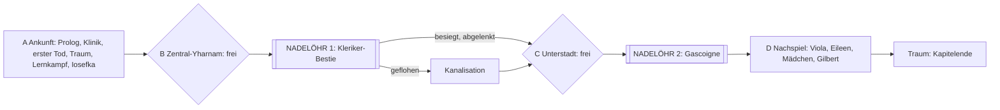

# Kapitel 1: Yharnam — Struktur (Raster)

Stand 2026-11-03. **Kapitel 1 ist vollständig ausgeschrieben (rund 15.700 Wörter) und im Browser spielbar** (`npm run spielen`). Struktur, Prüfer und Szenarien sind grün.

- Quelle der Wahrheit: `story/kapitel1/*.ink`, `story/system.ink`, `story/traum.ink`
- Erzählbaum wie in Twine (alle 120 Passagen, mit Text): https://claude.ai/artifact/NPHhjkNgsNCP2FrLbTGFUX · Twine-Datei: [`yharnam-kapitel1.twee`](yharnam-kapitel1.twee)
- Grobe Knotenkarte: [`karte-kapitel1.md`](karte-kapitel1.md) (wird erzeugt, GitHub zeigt sie an)
- Recherche: [`recherche/kapitel1.md`](recherche/kapitel1.md), [`recherche/vorgeschichte.md`](recherche/vorgeschichte.md)

---

## 1 Ablauf

| Teil | Freiheit | Orte |
|---|---|---|
| A Ankunft | geführt, Haltungen | Prolog, Klinik, Erwachen, Jägertraum, Lernkampf, Iosefkas Tür, erste Laterne |
| B Zentral-Yharnam | **frei**, beliebige Reihenfolge | Gilbert, Türen und alte Frau, Scheiterhaufen, Mädchen, Gasse mit Schütze, Eileen auf dem Dach, Traum |
| Nadelöhr 1 | drei Wege | Große Brücke |
| C Unterstadt | **frei** | Kanalisation, Gräber (Gascoigne), Eileen über den Gräbern, Leiter zurück nach B |
| Nadelöhr 2 | Pflicht | Grab des Oedon |
| D Nachspiel | frei | Viola, Eileen, Mädchen, Gilbert, Kanalisation, Traum |

---

## 2 Spielsysteme

| System | Regel |
|---|---|
| **Leben** | 5, unsichtbar. Vignette: bei 3 leicht orange, bei 2 leicht rot, bei 1 schwarz. |
| **Blutampulle** | Höchstens eine; heilt 2. In Ruhe gefahrlos; mitten im Angriff trifft der Gegner dabei (1 bis 2 Schaden, Trinken tötet nie). Iosefka gibt die erste, der Traum füllt auf. |
| **Tod** | Erwachen im Traum, volle Leben, zurück zur letzten Laterne. Die Blutechos bleiben am Todesort und werden beim Betreten aufgehoben; ein zweiter Tod vorher löscht sie. |
| **Lernen durch Sterben** | Jedes Anzeichen, an dem du stirbst, erkennst du beim nächsten Mal (eigener Satz im Kampf). |
| **Laternen** | Zentral-Yharnam (immer), Große Brücke (**nur wenn die Kleriker-Bestie besiegt ist**), Grab des Oedon (nach Gascoigne). Wer die Bestie umgeht, hat in der Unterstadt keine Laterne und lange Rückwege. |
| **Abkürzung** | Die Leiter in der Kanalisation verbindet Unterstadt und Zentral-Yharnam, ohne Brücke. |
| **Jägermarken** | Von Eileen (2). Zerdrücken heißt: in den Traum, ohne zu sterben (Echos bleiben). In den Bosskämpfen nutzbar. |
| **Einsicht** | +1 beim ersten Anblick der Kleriker-Bestie, +1 beim Sieg, +1 beim ersten Anblick Gascoignes, +1 beim Sieg. Bei Einsicht 1 erwacht die Puppe (Kanon). |
| **Blutgedächtnis** | Wer den Kopf der besiegten Kleriker-Bestie berührt, sieht ihre Erinnerung: wie ein Kleriker kippt und dass ein Rest Mensch bleibt. Das öffnet bei Gascoigne den Moment der Klarheit. Spätere Bosse geben weitere Erinnerungen (Vorgeschichte). |
| **Laden der Boten** | Molotow (3 Echos), Kieselstein (1 Echo). |

---

## 3 Figuren und ihre Bögen

| Figur | Begegnungen | Was man gewinnen oder verlieren kann |
|---|---|---|
| **Gascoigne** | Scheiterhaufen (rettet dich vor dem Mob, lehrt die Parade, bittet um einen Gruß an seine Frau) → Brücke (als Helfer rufbar, summt das Lied der Spieluhr, kann nicht aufhören) → Gräber (kippt; erinnern, warnen, nach Viola fragen) → Grab des Oedon (Boss) | Freundschaft (Wert `gascoigne`), Parade, Moment der Klarheit, sein letztes Wort |
| **Eileen** | Dach über dem Kanaleingang (Jägerin der Jäger, Jägermarken, fragt nach Gascoigne) → Dach über den Gräbern (erklärt, wie Jäger kippen; man bittet um Schonung, bietet Zusammenarbeit an oder schweigt) → Nachspiel (Urteil) | **Angebot der Partnerschaft für Kapitel 2** (vor der Kapelle, Henryk), Bruch, wenn man Gascoigne vor ihr warnt |
| **Das Mädchen** | Fenster am Brunnenplatz (Spieluhr, Suche nach der Mutter) → Nachspiel (Brosche, Wahrheit, Lüge, Schweigen) | Spieluhr; ihr Leben (Kanon: kein Ausgang rettet sie endgültig) |
| **Gilbert** | Fenster an der Laterne (Stadt, Jagd, Kirche, Brücke; Feuer; Bitte) → Bericht nach der Brücke | Feuer, Freundschaft (zahlt sich beim Blutmond aus) |
| **Iosefka** | Tür der Klinik (Ampulle, ihre Stimme) | Merkmal, an dem man in Kapitel 2 die Hochstaplerin erkennt |
| **Alte Frau** | Tür mit Hund | Versprechen eines sicheren Ortes (Kapitel 2) |
| **Gehrman, Puppe, Boten** | Traum | Lore, Laden, Puppe erwacht |

---

## 4 Weichen und Folgen

| Entscheidung | Sofort | Später in Kapitel 1 | Ab Kapitel 2 |
|---|---|---|---|
| Herkunft, Grund | – | – | eigene Möglichkeiten, persönlicher Faden |
| Waffe, Feuerwaffe | – | (Sprache der Kämpfe beim Ausschreiben) | – |
| Gilbert freundlich / abweisend | Feuer, Bitte | Bericht | sein Ende beim Blutmond |
| Mob kämpfen / umgehen / Feuer | Wunden | Gascoigne trifft dich in jedem Fall | – |
| **Mädchen sofort fortschicken** (falsch) | keine Spieluhr | **Band beim Schwein in der Kanalisation**; kein Moment mit Gascoigne | – |
| Eileen: Gascoigne verteidigen / verraten / nichts | Freundschaft oder Verrat | Gascoigne kann nicht mehr gerufen werden, wenn verraten; Eileens Dank am Grab | Eileen und Henryk |
| Eileen über den Gräbern: Schonung erbitten / Zusammenarbeit anbieten / schweigen | Vertrauen | Mit genug Vertrauen (und ohne Warnung an Gascoigne) bietet sie am Grab die Partnerschaft an | **Partnerschaft vor der Kapelle** |
| **Kleriker-Bestie** kämpfen allein / mit Gascoigne / ablenken / fliehen | Wunden, Einsicht | Laterne an der Brücke nur bei Sieg; Blutgedächtnis nur bei Sieg und Berühren | – |
| Gräber: Gascoigne erinnern / warnen / fragen | Freundschaft | Warnen = Eileen bricht mit dir | keine Partnerschaft |
| **Moment der Klarheit** (Freundschaft ≥ 2 + Spieluhr + Blutgedächtnis) | Versprechen | Gascoigne stirbt als Mensch; dem Mädchen kann man sagen, dass er an sie dachte | – |
| **Brosche geben** (Kanon-Tragödie) | Wahrheit | Haustür offen, **Band beim Schwein** auf dem Rückweg | – |
| Lügen / schweigen | sie wartet | – | Kapelle oder Klinik (beides schlimm) |

---

## 5 Kämpfe

Jeder Kampf: Anzeichen im Text, 2 bis 4 Möglichkeiten, feste Folge. Kein Zufall.

| Kampf | Takte | Anzeichen | Vorbereitung, die hilft |
|---|---|---|---|
| Bestie in der Klinik (Lernkampf) | 3 | Sprung, schwerer Hieb, Biss | – |
| Mob am Scheiterhaufen (optional) | 2 | Mistgabel, Ansturm des Riesen | Feuer |
| Schütze in der Gasse | 1 | Schuss von hinten | Dächer im Blick behalten |
| **Kleriker-Bestie** | 4 + Phase | langer Arm, Kreischen, Sprung | Feuer, Molotow, Parade, Gascoigne als Helfer |
| Schwein in der Kanalisation (optional) | 2 | Ansturm, Biss | – |
| **Gascoigne** | 3 Phasen, 5 Takte | Donnerbüchse, Axt, lange Axt, Bestiensprung, Griff | Parade (seine eigene Lehre), Spieluhr (dreimal = Bestie), Feuer, Molotow |

---

## 6 Lore in Kapitel 1

21 Kern-Lore-Einträge; jeder ist an mindestens zwei Stellen erreichbar (vom Prüfer erzwungen). Häufigkeit in 3.000 Zufallsdurchläufen: die meisten 100 %, am seltensten die Spieluhr (53 %), Jägerin der Jäger (73 %), Blutgedächtnis (84 %). Zufällige Spieler verpassen mehr als echte; echte Spieler werden geführt.

Bluttransfusion · bleiches Blut · Jägertraum · Puppe · Boten · Laternen · Jagdnacht · Räucherwerk · Bürgerjagd · Fremde · Heilende Kirche · Bestienseuche · Kleriker-Bestien · Blutgedächtnis · Blutrausch · Jägerin der Jäger · Parade · Gascoigne · Familie Gascoigne · Spieluhr · Oedon

Bewusst offen: Was ist bleiches Blut? Wer hält den Traum? Wer oder was ist Oedon? Wer hat Viola getötet?

---

## 7 Abweichungen vom Kanon ([ERWEITERT])

1. Prolog vor der Klinik (Herkunft, Grund).
2. Gascoigne rettet dich am Scheiterhaufen, lehrt die Parade, bittet um den Gruß an seine Frau.
3. Gascoigne an den Gräbern vor dem Kampf (zweite Begegnung).
4. Moment der Klarheit im Kampf.
5. Gilberts Feuer schon in Kapitel 1 (im Original später).
6. Das Mädchen kann man schon vor Gascoigne fortschicken.
7. Eileens zweite Begegnung über den Gräbern und ihr Angebot der Partnerschaft (die gemeinsame Jagd folgt in Kapitel 2).
8. Ablenken und Fliehen an der Brücke; Blutgedächtnis.
9. Der Schütze in der Gasse als feste Szene.

Kanon nah am Original: Klinik, Vertrag, Notiz, erster Tod, Traum, Iosefkas Tür, Gilbert, Mädchen und Spieluhr (Namen im Deckel), Kleriker-Bestie mit Abzeichen, Gascoigne als rufbarer Helfer, drei Phasen, Spieluhr dreimal, Viola auf dem Dach, Brosche, Schwein und Band, Eileen auf dem Dach mit Marken, Laternen.

---

## 8 Prüfung (`npm run check`)

- Kompiliert ohne Fehler und Warnungen.
- 3.000 Zufallsdurchläufe: 0 steckengeblieben, alle erreichen das Kapitelende, beide Nadelöhre in jedem Lauf.
- Jeder der 37 Knoten wird erreicht.
- 8 Szenarien erreichbar: bester Weg (Moment der Klarheit), Mädchen weggeschickt, Bestie abgelenkt, Flucht, Verrat und Eileens Angebot, Warnung und Bruch, Lüge, Kanon-Tragödie.
- Browser-Test (Chromium): Start mit Namen, Kampf mit Vignette (orange bei 3, rot bei 2), Notizbuch, Fortsetzen nach Neuladen, keine Fehler in der Konsole.
- Offene Kanon-Prüfstellen: 5 (Einzelheiten der Vision, Reihenfolge im ersten Traum, Gilberts Übergabezeitpunkt, Waren der Boten, Einzelheiten des Traums).

---

## 9 Entschieden

- Eileen: in Kapitel 1 zwei Begegnungen, die Partnerschaft beginnt in Kapitel 2 (Nutzer, 2026-11-03).
- Erzählweise: Du-Form im Präsens, Lovecraft-Ton; Kapitelanfang und -ende als Auszüge aus den Aufzeichnungen des Jägers.
