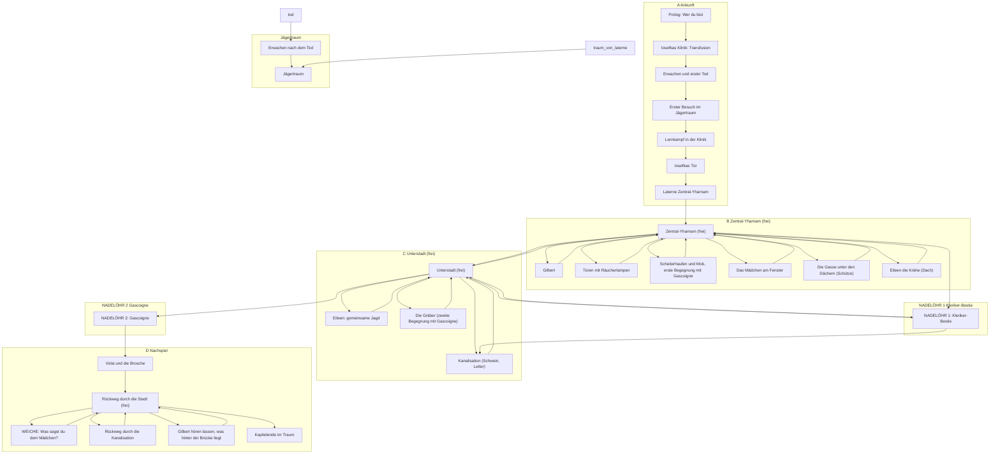

# Karte Kapitel 1 (automatisch erzeugt)

Erzeugt mit `npm run karte` aus den Ink-Dateien. Nicht von Hand bearbeiten.
Ausgeblendet sind Bausteine, die überall vorkommen (Tod, Ampulle, Laterne, Traum-Laden).

