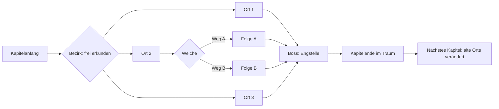
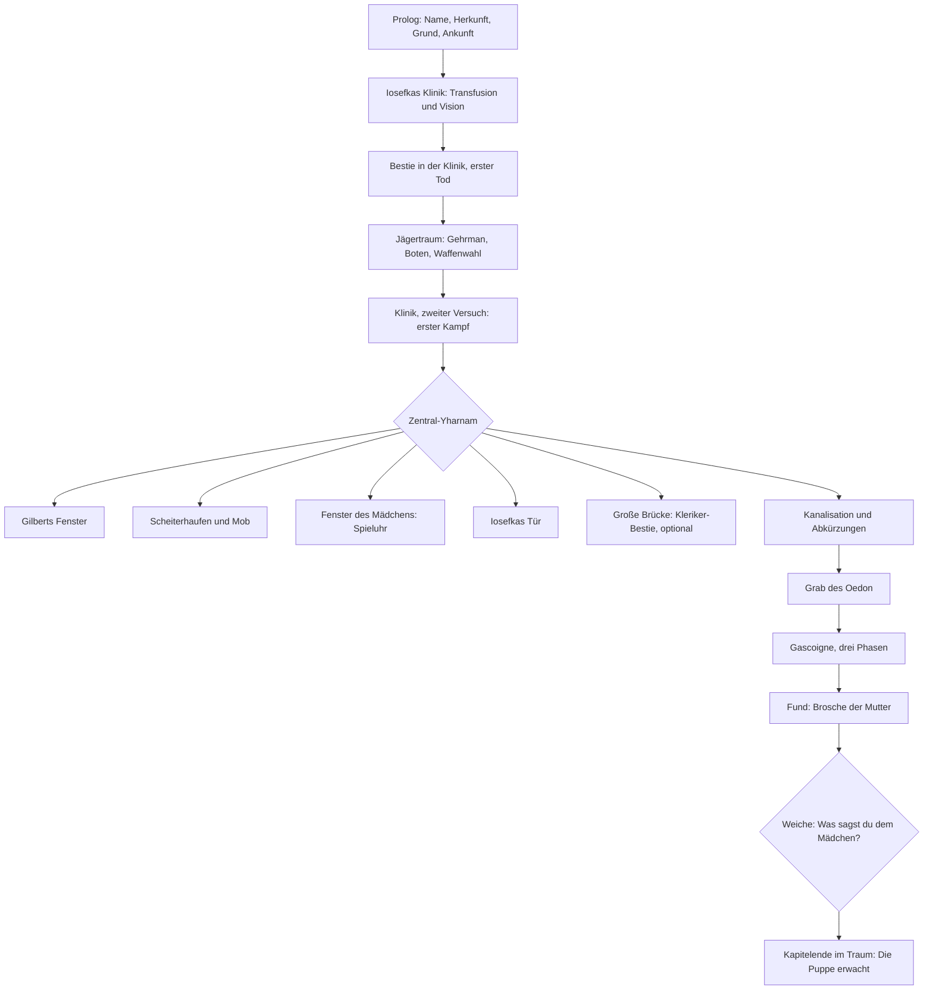

# Bloodborne als eigenes Erzählspiel: Spieldesign-Entwurf

Stand 2026-11-03. **Entwurf zur Diskussion, noch nichts davon ist gebaut** außer einer kleinen Machbarkeitsprobe (Abschnitt 11). Dieses Dokument ersetzt die Richtung von `bloodborne.md` (KI-Spielleiter, der live improvisiert) durch ein **geschriebenes, verzweigtes Spiel**. Was aus `bloodborne.md` weiter gilt, steht in Abschnitt 1.

**Kanon-Hinweis:** Alle Angaben zur Handlung von Bloodborne in diesem Dokument stammen aus meinem Gedächtnis und den Suchzusammenfassungen in `bloodborne.md` Kapitel 14. Sie sind **nicht gegen Quellen geprüft** (das Netz dieser Sitzung sperrt Wiki und Wikipedia). Vor dem Schreiben eines Kapitels wird seine Kapitel-Bibel geprüft.

> **Stand in diesem Repo (2026-11-03):** Dieses Dokument ist der Entwurf aus dem AI-Dungeon-Master-Repo. Seitdem hat der Nutzer entschieden (verbindlich, siehe `CLAUDE.md`):
> - **Eine** Blutampulle (heilt 2 von 5 unsichtbaren Leben), Vignette bei 3/2/1 Leben; Trinken im falschen Moment kostet einen Treffer.
> - Kämpfe ohne Zufall, nur Deutsch, Kanon mit wenigen markierten Erweiterungen.
> - Kapitel 1 mit **zwei Nadelöhren**: Kleriker-Bestie (kämpfen, ablenken, fliehen) und Gascoigne (Pflicht).
> - Die Kleriker-Bestie gibt über das **Blutgedächtnis** eine Information, die später eine bessere Entscheidung möglich macht.
> - Figuren tiefer als im Original: Freundschaft mit Gascoigne, Partnerschaft mit Eileen.
> - **Rückholen (Abschnitt 6.2) ist nicht gebaut**; offen, ob es kommt.
> Das Raster von Kapitel 1 steht in `kapitel1-struktur.md`; es ersetzt Abschnitt 9 dieses Dokuments.

---

## 0 Was ich davon halte

1. **Die Idee passt besser zu deinen Zielen als der KI-Spielleiter.** Du willst Lore-Treue, eine richtig gute Geschichte und Führung. Ein improvisierender Erzähler kann Bloodborne nicht verlässlich nacherzählen; er erfindet, vergisst und erklärt zu viel. Ein geschriebenes Spiel kann jeden Satz, jede Andeutung und jeden Gänsehautmoment an die richtige Stelle setzen.
2. **Der Preis ist Schreibarbeit statt Engine-Arbeit.** Die Technik ist klein, der Text ist groß. Ich schreibe, du liest gegen und entscheidest. Dafür gibt es keine Laufkosten, keinen API-Schlüssel, und das Spiel läuft offline und in immer gleicher Qualität.
3. **Der wichtigste Designgriff: Lore-Zugang und Schicksal trennen.** Wissen ist immer über mehrere Wege erreichbar (jede wichtige Lore an mindestens zwei Stellen). Entscheidungen verändern Schicksale von Menschen, Szenen und Enden, aber nie, *ob* du die Lore zu sehen bekommst. So nimmt der Spieler „alles mit“ und hat trotzdem Entscheidungen mit echten Folgen.
4. **Der zweite Griff: Wissen ist Waffe.** Wer erkundet, zuhört und liest, bekommt in Gesprächen und Kämpfen bessere Möglichkeiten. Das Vorbild steht im Original selbst: die Spieluhr, die Gascoigne innehalten lässt.
5. **Das größte Risiko ist der Umfang.** Darum zuerst ein Vertikalschnitt (ein kleines, fertiges Stück von Kapitel 1), dann Kapitel für Kapitel.

---

## 1 Was vom bisherigen Plan bleibt

| Aus `bloodborne.md` | Im neuen Spiel |
|---|---|
| KI-Spielleiter, der live erzählt | **entfällt.** Kein Modell zur Laufzeit. Claude ist Autor, nicht Spielleiter |
| Lore-Karten in drei Schichten (Kanon, Deutung, Offen) | werden das **Notizbuch des Jägers** (Abschnitt 5) |
| Ansage und Konter im Kampf | bleibt, aber **geschrieben**: jedes Anzeichen und jede Folge ist Text, keine Engine-Würfel |
| Einsicht | bleibt als Wert, der Text und Möglichkeiten freischaltet |
| Tod als Erwachen im Jägertraum | bleibt, mit Lernen durch Sterben (Abschnitt 6.4) |
| Stilbibel, zwei Register (Gotik, später Kosmos) | wird meine verbindliche Schreibregel |
| Ortsbilder, Spotify-Stimmungen, Geräusche, Verletzungs-Vignette, Silhouetten | bleiben; die Komponenten aus dem AI-Dungeon-Master werden übernommen |
| Weichen-Netz mit zusammenlaufenden Wegen | wird zum **eigentlichen Spiel** |

---

## 2 Das Spiel in einem Absatz

Du kommst als Fremder nach Yharnam, weil man sagt, das Blut der Stadt heile alles. Du unterschreibst einen Vertrag, den du nicht verstehst, und erwachst in einer Nacht, in der die Stadt Jagd auf das macht, was aus ihren Bewohnern geworden ist. Von Kapitel zu Kapitel gehst du tiefer: von der Straße in die Kathedrale, von der Kathedrale in die Wälder, von dort in Dinge, für die es keine Worte gibt. Das Spiel führt dich durch Bloodbornes Geschichte und erklärt dir, was ein Jäger verstehen kann. Wohin du in jedem Bezirk gehst, wem du hilfst, wen du belügst und wann du zu viel siehst, entscheidest du. Manche Entscheidungen sind richtig, manche falsch, manche haben keine gute Lösung. Die Geschichte findet immer zusammen, aber nicht jeder, den du getroffen hast, kommt mit.

---

## 3 Struktur: Fäden mit Knoten

Die Fachbezeichnung ist *Branch and Bottleneck* (Verzweigung und Engstelle), verbunden mit Zuständen, die später Text färben. Das ist dasselbe Prinzip wie in den Spielen von inkle (*80 Days*, *Sorcery!*) und in vielen Twine-Spielen.

### 3.1 Drei Arten von Entscheidungen
| Art | Beispiel | Wirkung | Wie viele |
|---|---|---|---|
| **Wege** | Erst zu Gilbert oder erst zur Brücke? | Reihenfolge, kleine Textreaktionen | viele |
| **Haltungen** | Freundlich, knapp oder abweisend | färben Figuren, spätere Sätze, kleine Vorteile | viele |
| **Weichen** | Dem Mädchen die Wahrheit sagen? | ändern Schicksale, öffnen oder schließen Szenen, führen zu Enden | 2 bis 4 je Kapitel |

### 3.2 Richtig und falsch, aber nie willkürlich
- **Jede „falsche“ Entscheidung ist für Aufmerksame vorher erkennbar**: ein Satz zu viel, eine Stimme, die nicht passt, ein Notizbuch-Eintrag. Wer genau liest, entscheidet besser. Das macht Lore zum Werkzeug.
- **Manche Lagen haben keine gute Lösung.** Das ist Bloodborne. Das Spiel sagt es nicht vorher und tröstet nicht hinterher.
- **Keine Sofort-Tode durch Entscheidungen außerhalb von Kämpfen.** Falsche Entscheidungen kosten Menschen, Vertrauen, Wege und Enden, nicht den Spielstand.

### 3.3 Folgen sichtbar machen, ohne zu spoilern
- Nach einer Weiche ein leiser Satz im Notizbuch („Sie wird sich daran erinnern.“), wie im Weichen-Netz des AI-Dungeon-Masters (`journal` am Weg).
- Spätere Szenen greifen frühere Taten auf (ein anderer Gruß, ein verschlossenes Fenster, ein Name, den jemand behalten hat). Viele kleine Echos fühlen sich nach mehr Freiheit an als wenige große Abzweigungen.
- Am Ende des Spiels eine **Chronik der Nacht**: was aus jedem Menschen wurde, den du getroffen hast.

---

## 4 Freiheit trotz Führung

- **Jedes Kapitel ist ein Bezirk** mit 6 bis 10 Orten. Die Reihenfolge ist frei. Einige Orte öffnen sich erst über Abkürzungen (Tür von innen, Leiter herunterlassen) oder Gegenstände. Das ist das Gefühl von Bloodbornes Stadtplan in Textform.
- **Der Hauptfaden ist immer im Notizbuch sichtbar** („Spur: Die Brücke zum Kathedralenbezirk ist versperrt.“). Wer sich verläuft, findet zurück.
- **Die Stadt ruft**: Wer lange abseits bleibt, hört Glocken, Schreie oder Schritte, die zum Hauptfaden ziehen.
- **Kein Zeitdruck innerhalb eines Kapitels**, damit niemand Angst haben muss, etwas zu verpassen. Die Nacht schreitet *zwischen* den Kapiteln voran und verändert alte Orte. Wer zurückkehrt, findet sie anders vor.
- **Untersuchen statt Rätselraten**: In jedem Ort gibt es einmalige Untersuchungen („Den Leichnam durchsuchen“, „An der Tür lauschen“). Was man findet, landet im Notizbuch.

---

## 5 Lore erklären, ohne das Geheimnis zu töten

Du willst, dass Dinge erklärt werden. Bloodborne lebt davon, dass vieles offen bleibt. Beides geht mit vier Werkzeugen:

1. **Der Erzähler erklärt, was der Jäger versteht.** Beim ersten Kontakt mit etwas Wichtigem (Bluttransfusion, Jagdnacht, Jägertraum) ein bis drei klare Sätze im Fließtext. Danach nie wieder dieselbe Erklärung.
2. **Das Notizbuch des Jägers.** Einträge mit Stufen, die sich füllen:
   - *Was man in Yharnam erzählt* (Gerüchte, Kirchenlehre, oft falsch)
   - *Was du gesehen hast* (deine Erlebnisse)
   - *Was du ahnst* (erst mit Einsicht, Andeutungen der Wahrheit)
   Jeder Eintrag zeigt, wann er sich geändert hat. Kanon steht als Tatsache, Deutung nur in der Stimme einer Figur, Offenes bleibt offen.
3. **Begriffe zum Antippen.** Wichtige Wörter im Text sind markiert und zeigen den aktuellen Stand deines Wissens, nicht mehr.
4. **Fragen der Nacht.** Eine Liste offener Fragen, die du sammelst („Was ist Paleblood?“, „Wer ist der Mann im Rollstuhl?“). Manche werden beantwortet, manche nie. Am Kapitelende: *Was du jetzt weißt* und *Was offen bleibt*. Das macht Lore zum Antrieb statt zur Vorlesung.

---

## 6 Kämpfe als Erzählung

### 6.1 Aufbau
- Ein Kampf hat 3 bis 6 **Takte**. Jeder Takt: ein **Anzeichen** im Text („Sie duckt sich tief, die Hinterläufe spannen sich.“), dann 3 bis 4 Möglichkeiten, dann eine geschriebene Folge.
- Möglichkeiten sind **richtig, riskant oder falsch**. Richtig kostet nichts, riskant kann mehr bringen oder kosten, falsch kostet Blut.
- **Bosse haben Phasen**: Bei einer Wende ändert sich die Szene und die Anzeichen ändern sich mit.

### 6.2 Werte (so wenige wie möglich)
- **Blut**: 5 Tropfen. Am Bildschirm als Vignette und Tropfen, nie als Zahlenkolonne.
- **Blutampullen**: wenige, im Traum oder bei Iosefka nachzufüllen.
- **Rückholen**: Wer gerade getroffen wurde und im nächsten Takt richtig angreift, bekommt einen Tropfen zurück. Das belohnt Mut wie im Original.
- **Einsicht** (Abschnitt 7).

### 6.3 Waffe und Vorbereitung
- Die **Wandelwaffe**, die du im Traum wählst, prägt Möglichkeiten und Sprache im ganzen Spiel (eine Säge reißt, eine Axt spaltet, ein Stock peitscht).
- Die **Feuerwaffe** öffnet die Parade: im richtigen Moment geschossen, taumelt der Gegner, und es folgt ein Viszeralangriff.
- **Vorbereitung zählt**: Gilberts Feuer gegen Bestien, die Spieluhr gegen Gascoigne, ein Notizbuch-Eintrag über eine Schwäche. Jede gibt im Kampf eine zusätzliche, bessere Möglichkeit.

### 6.4 Tod und Lernen
- Blut auf null heißt **Erwachen im Jägertraum**, nicht Spielende. Der Kampf beginnt beim nächsten Versuch neu.
- **Beim zweiten Versuch lernst du**: Im Halbschlaf siehst du das Anzeichen wieder, das dich getötet hat, und es steht im Notizbuch. Damit wird „Lernen durch Sterben“ im Text erlebbar statt Auswendiglernen.
- Die Puppe und Gehrman reagieren auf deine Tode, mit eigenen kurzen Texten.
- **Ohne Würfel (Empfehlung):** Gleiche Wahl, gleiche Folge. Das passt zu „set and done“ und macht Kämpfe lernbar. Optional könnten riskante Möglichkeiten einen kleinen, festen Zufall bekommen (offene Entscheidung, Abschnitt 13).

---

## 7 Einsicht

- Steigt an festen Stellen: Begegnungen mit etwas Großem, Bosse, verbotene Schriften.
- **Schaltet frei**: andere Beschreibungen derselben Orte, verborgene Möglichkeiten, die Stufe *Was du ahnst* im Notizbuch.
- **Kostet**: Angst in bestimmten Szenen, schwierigere Möglichkeiten. Später lässt sie sich ausgeben (bei den Boten), dann sieht man weniger und ist sicherer.
- **Kapitel 1** endet mit dem ersten Punkt Einsicht: Die Puppe im Traum erwacht und spricht zum ersten Mal. Ein leiser, starker Kapitelschluss.

---

## 8 Spielbeginn: Wer du bist

1. **Name** (frei eingegeben).
2. **Herkunft** (5 bis 6, eigene Fassung statt der Originalbezeichnungen, etwa: verarmter Adel, Soldat, Gelehrter, einziger Überlebender, Kranker, Gesuchter). Jede Herkunft öffnet 1 bis 2 eigene Möglichkeiten pro Kapitel und färbt, wie Figuren dich sehen.
3. **Grund für Yharnam** (Heilung für dich, Heilung für jemanden, eine Suche, eine Schuld). Das ist dein persönlicher Faden, der in einem späteren Kapitel eingelöst wird.
4. **Wandelwaffe und Feuerwaffe** wählst du nach dem ersten Tod im Traum, wie im Original.

---

## 9 Kapitel 1: Yharnam (Entwurf)

**Ziel:** Ankommen, Angst verstehen, die Regeln der Nacht lernen. **Register:** gotische Volkskunde (Aberglaube, verriegelte Türen, Seuche, Jagd). **Engstellen:** Kleriker-Bestie (optional) und Gascoigne (Pflicht). **Länge:** grob 12 bis 15 Szenen, geschätzt 15.000 bis 25.000 Wörter.

| # | Szene | Was passiert | Lore, die man mitnimmt | Entscheidung, Folge |
|---|---|---|---|---|
| 0 | **Prolog** (eigene Szene vor dem Original) | Reise, Krankheit oder Suche, Ankunft am Stadttor | Ruf des Heilbluts, Fremde in Yharnam | Name, Herkunft, Grund |
| 1 | **Iosefkas Klinik** | Bluttransfusion, alter Mann, Vertrag, Fiebervision | Bluttransfusion, Paleblood (nur als Notiz) | Haltung zum Vertrag (misstrauisch, hoffend) |
| 2 | **Erster Tod, Jägertraum** | Bestie in der Klinik, unausweichlicher Tod, Erwachen im Traum | Traum, Gehrman, Boten, Werkstatt | Wahl der Waffen |
| 3 | **Klinik, zweiter Versuch** | Lernkampf; Iosefkas Stimme hinter der Tür | Iosefka, Anzeichen lesen | Ampullen von Iosefka |
| 4 | **Zentral-Yharnam** (Hub) | Laterne, Straßen, Stimmen hinter Türen | Fremdenhass, Räucherwerk, Jagdnacht | freie Reihenfolge |
| 5 | **Gilberts Fenster** | kranker Fremder, erklärt die Stadt | Kirche, Kathedralenbezirk, Bestien und Feuer | Haltung; Feuer als Geschenk; Gilberts Gruß in späteren Kapiteln |
| 6 | **Scheiterhaufen** | Bürger jagen selbst, eine Bestie brennt | Bürgerjagd, Bestienseuche | kämpfen, schleichen, umgehen |
| 7 | **Fenster des Mädchens** | Gascoignes Tochter bittet, die Mutter zu suchen | Familie Gascoigne | Spieluhr annehmen; Versprechen geben oder nicht |
| 8 | **Kanalisation, Abkürzungen** | Ratten, Unrat, eine Leiter von innen | Krankheit, Stadt unter der Stadt | Abkürzung öffnen; Vorahnung für eine spätere Szene |
| 9 | **Große Brücke** (optional) | Kleriker-Bestie | Warum ausgerechnet Geistliche zu den schlimmsten Bestien werden | stellen oder umgehen; Einsicht |
| 10 | **Grab des Oedon** | Gräber, ein Name, den niemand erklärt | Oedon (nur als Name, Offen) | – |
| 11 | **Gascoigne** | Jäger und Priester, der sich verliert; drei Phasen | Bestienverwandlung, Jäger, die zu weit gehen | Spieluhr nutzen oder nicht (bestimmt, wie der Kampf endet und was du danach weißt) |
| 12 | **Die Brosche** | Fund am Leichnam einer Frau | Was aus der Mutter wurde | **Weiche:** Wahrheit, Lüge oder Schweigen; Folge in Kapitel 2 und 3 |
| 13 | **Kapitelende im Traum** | Die Puppe erwacht | Puppe, Einsicht | *Was du jetzt weißt / Was offen bleibt* |

**Weichen in Kapitel 1:** Haltung zu Gilbert, Versprechen an das Mädchen, Kleriker-Bestie stellen oder umgehen, Wahrheit über die Mutter. Dazu Iosefkas Bitte, niemanden hereinzulassen (sie zahlt sich erst in Kapitel 2 aus).

**Notizbuch nach Kapitel 1 (Auswahl):** Yharnam, Bluttransfusion, Heilende Kirche, Jagdnacht, Bestienseuche, Jäger, Jägertraum, Gehrman, Puppe, Boten, Blutechos, Fremde, Gilbert, Familie Gascoigne, Oedon, Paleblood, Kleriker-Bestie, Wandelwaffen.

**Fragen der Nacht nach Kapitel 1:** Was ist Paleblood? Wer war der Mann im Rollstuhl? Wer hält den Traum? Warum werden Menschen zu Bestien, und warum gerade Geistliche? Wer oder was ist Oedon?

**Prüfen vor dem Schreiben:** Lage des Mädchens und der Mutter, was genau Gilbert gibt und sagt, Iosefkas Rolle, was die Spieluhr im Kampf bewirkt, welche Ausgänge das Mädchen im Original haben kann. Das sind genau die Stellen, an denen mein Gedächtnis danebenliegen kann.

---

## 10 Die weiteren Kapitel (Grobplan, ungeprüft)

| Kapitel | Bezirk | Bosse (Auswahl) | Register |
|---|---|---|---|
| 2 | Kathedralenbezirk, Alt-Yharnam | Blutdurstige Bestie, Vikarin Amelia | Kirche, Heilung als Lüge |
| 3 | Hemwick, Verbotene Wälder | Hexe von Hemwick, Schatten von Yharnam | Wahn, Augen, das Unsichtbare |
| 4 | Byrgenwerth, der Mondsee | Rom | Wendepunkt: Blutmond, die Welt kippt ins Kosmische |
| 5 | Yahar'gul, Albtraum-Grenze, Albtraum von Mensis | Der Wiedergeborene, Micolash, Mergos Amme | Kosmischer Horror |
| 6 | Der Traum | Gehrman, Mondpräsenz | Die drei Enden |
| optional | Cainhurst, Obere Kathedrale, Albtraum der Jäger (Zusatzinhalt) | u. a. Ebrietas, Lady Maria, Waise von Kos | Seitenwege mit eigener Lore |

Die Reihenfolge und Grenzen der Kapitel sind ein erster Vorschlag. Vor jedem Kapitel entsteht eine geprüfte Kapitel-Bibel.

---

## 11 Technik

### 11.1 Empfehlung: Ink und eine kleine Web-Oberfläche
**Ink** ist die Erzählsprache von inkle (Studio hinter *80 Days*, *Heaven's Vault*). **inkjs** ist die JavaScript-Fassung. Hier geprüft: Version 2.4.0, MIT-Lizenz, mit Compiler. Damit lässt sich das Spiel im Browser und in Tests ausführen.

| | Ink + inkjs | Twine (Harlowe/SugarCube) | Eigene JSON-Engine |
|---|---|---|---|
| Schreiben großer Mengen | sehr gut, reiner Text | im Editor mühsam, als Twee-Text möglich | mühsam |
| Zustände, Bedingungen, wiederverwendbare Kampf-Bausteine | eingebaut | möglich, aber verstreut | alles selbst bauen |
| Baum sehen | aus dem Text als Diagramm erzeugbar | eingebaute Karte | selbst bauen |
| Für dich bearbeitbar | Texteditor oder Inky (Desktop-Editor zum Spielen und Ändern) | grafischer Editor | nur mit Code |
| Automatisch testbar | ja (siehe 11.3) | eingeschränkt | ja |
| Eigene Oberfläche | voll, mit React | an Twine-Formate gebunden | voll |

**Warum nicht Twine?** Twine ist schön, um den Baum zu sehen. Bei hunderten Szenen mit Zuständen wird es unübersichtlich, und meine Arbeit (große Textmengen, Git, Vergleich von Änderungen) passt schlechter dazu. Den Baum zeigen wir trotzdem: Er lässt sich aus der Ink-Datei als Diagramm erzeugen.

### 11.2 Was aus dem AI-Dungeon-Master übernommen wird
Dunkle Oberfläche und Schrift, `SceneBackdrop` (Ortsbild hinter dem Text), `InjuryVignette` (Blut), Geräusche und `useAudio`, Spotify-Stimmungen, Silhouetten, die Gestaltung von Journal und Hilfe. **Nicht übernommen:** Spielleiter, Prompts, Anbieter, Datenbank, Werkstatt. Spielstände liegen im Browser und lassen sich als Datei sichern. Ein Server ist nicht nötig. Das Spiel kann trotzdem auf deinem VPS laufen.

**Tags im Text steuern die Präsentation**, ohne dass der Erzähltext Technik enthält: `# bild: bruecke`, `# stimmung: spannung`, `# klang: glocke`, `# notiz: jagdnacht`, `# anzeichen: sprung`, `# einsicht`, `# kapitel: ende`.

### 11.3 Machbarkeitsprobe (heute gemacht)
- `docs/analyse/bloodborne-beispiel.ink`: Hub mit freier Reihenfolge, Gilbert mit Haltung und späterem Echo, Feuer als Vorbereitung, Kampf in zwei Takten mit Anzeichen, Wunden, Ampulle, Tod, Erwachen im Traum mit gelerntem Anzeichen, Notizbuch-Tags. Eigene Prosa.
- `docs/analyse/bloodborne-pruefer.mjs`: kompiliert die Datei mit inkjs und spielt sie tausendfach mit zufälligen Entscheidungen durch.
- **Ergebnis (3.000 Durchläufe):** kompiliert ohne Fehler und Warnungen; 0 Sackgassen, 0 Endlosschleifen; jeder Durchlauf erreicht das Ende; 4 % sterben mindestens einmal; 35 % bekommen Gilberts Feuer.
- **Der Prüfer hat einen echten Fehler gefunden:** Ich hatte Kampfoptionen als einmalig wählbar geschrieben. Nach einem Tod wären sie im zweiten Versuch verschwunden. Behoben (Kampfoptionen sind jetzt wiederholbar). Genau solche Fehler soll der Prüfer in einem großen Spiel finden.

### 11.4 Prüfungen ohne KI, wie in deinem Repo üblich
Kompilieren; jeder Knoten erreichbar; tausende Zufallsdurchläufe (Sackgassen, Schleifen, Todesquote je Kampf, Erreichbarkeit jeder Weiche und jedes Endes); jede Lore mindestens zweimal erreichbar; Wortzahl je Kapitel; kein Notizbuch-Eintrag ohne Fundstelle.

### 11.5 Wo das Spiel liegt
Ich kann in dieser Sitzung kein neues Repository anlegen. Zwei Wege: ein Ordner `spiele/yharnam/` in diesem Repo (sofort möglich, später verschiebbar) oder ein neues Repo, das du anlegst und mir freigibst. Für „ein eigenes Spiel“ wäre ein eigenes Repo sauberer.

---

## 12 Umfang und Ablauf

- **Kapitel 1:** etwa 12 bis 15 Szenen, 2 Bosse, 4 Weichen, rund 15 Notizbuch-Einträge, geschätzt 15.000 bis 25.000 Wörter.
- **Ganzes Spiel:** 6 Kapitel plus optionale, geschätzt 100.000 bis 180.000 Wörter. Das ist ein Roman. Darum Kapitel für Kapitel.
- **Ablauf je Kapitel:** Kapitel-Bibel (geprüfte Fakten) → Szenenplan mit Weichen (du stimmst zu) → ich schreibe in Ink → automatische Prüfungen → du spielst und markierst → Feinschliff.
- **Vertikalschnitt zuerst:** Prolog, Klinik, erster Traum, Zentral-Yharnam mit Gilbert und Kleriker-Bestie (etwa 5.000 Wörter), spielbar im Browser mit Bild, Klang und Notizbuch. Daran entscheidest du, ob Ton, Erklärungen und Kämpfe stimmen, bevor der Rest entsteht.

---

## 13 Entscheidungen für dich

1. **Kämpfe ohne Zufall** (gleiche Wahl, gleiche Folge; meine Empfehlung) oder mit kleinem Zufall bei riskanten Möglichkeiten?
2. **Eigene Szenen und Nebenfiguren zwischen dem Kanon erlaubt?** Etwa der Prolog vor der Klinik oder ein Bürger hinter einer Tür, der wiederkehrt. Ich empfehle wenige, klar markierte; der Kanon bleibt das Rückgrat.
3. **Ort:** Ordner in diesem Repo oder ein neues Repo?
4. **Sprache:** nur Deutsch (empfohlen; zwei Sprachen verdoppeln die Schreibarbeit)?
5. **Nächster Schritt:** Vertikalschnitt bauen? Dafür bräuchte ich vorher die Netzfreigabe für die Kanonprüfung (`bloodborne.md` 14.0) oder deine Bestätigung, dass Kapitel 1 mit Prüfhinweisen geschrieben werden darf.

---

## 14 Risiken

| Risiko | Gegenmittel |
|---|---|
| Umfang eines Romans | Vertikalschnitt, dann Kapitel für Kapitel |
| Kanonfehler aus meinem Gedächtnis | geprüfte Kapitel-Bibel, du als zweite Instanz |
| Freiheit fühlt sich nach Auswahlliste an | Bezirke mit freier Reihenfolge, Untersuchungen, Haltungen, viele kleine Echos |
| Kämpfe werden Rätselraten | klare Anzeichen, Lernen durch Sterben, Hinweise im Notizbuch |
| Erklärungen töten das Geheimnis | drei Schichten, Fragen der Nacht, keine Auflösung des Offenen |
| Recht | Nacherzählung ist stärker abgeleitet als eine eigene Welt. Privat unkritisch; Veröffentlichung mit Namen ist riskant (Belege in `bloodborne.md` 14.6) |
